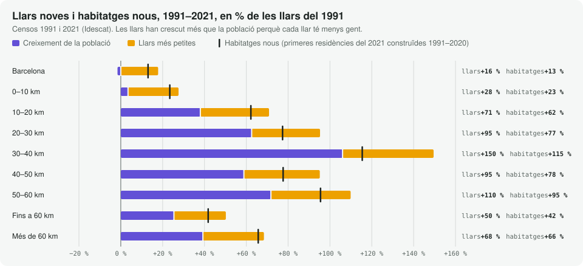

# Catalunya en relleu

Mapa 3D de la població dels municipis de Catalunya, de 1981 a 2026, centrat en el voltant de Barcelona.

**Pàgina web: https://brunomazorra.github.io/catalunya-relleu/**

Cada municipi és un prisma: l'alçada és la densitat de població i el color, el canvi de població des de 1981. La barra de temps va de 1981 a 2026, i els cercles marquen la distància a la plaça de Catalunya cada 10 km. A sota del mapa hi ha gràfiques de població, habitatge i persones per llar per anells de distància, amb taules de dades.

## Què mostra

Barcelona i els municipis a menys de 10 km tenen gairebé la mateixa gent que el 1981. Tot el creixement s'ha fet entre 10 i 60 km de Barcelona.


| Anell (distància a la plaça de Catalunya) | 1981 | 2026 (provisional) | Canvi |
|---|---:|---:|---:|
| Barcelona ciutat | 1.752.000 | 1.744.000 | 0 % |
| 0–10 km | 908.000 | 935.000 | +3 % |
| 10–20 km | 824.000 | 1.279.000 | +55 % |
| 20–30 km | 475.000 | 900.000 | +89 % |
| 30–40 km | 153.000 | 376.000 | +146 % |
| 40–50 km | 237.000 | 430.000 | +81 % |
| 50–60 km | 185.000 | 366.000 | +98 % |
| **Fins a 60 km** | **4.534.000** | **6.029.000** | **+33 %** |
| Més de 60 km | 1.416.000 | 2.182.000 | +54 % |
| **Catalunya** | **5.950.000** | **8.211.000** | **+38 %** |

Xifres arrodonides al miler. Cada municipi compta a l'anell on cau el seu centre; Barcelona es compta a part.

## Habitatge i llars

Entre 1991 i 2021, a menys de 60 km de Barcelona, les llars han crescut un 50 % i la gent que hi viu, un 25 %. La diferència és que cada llar té menys gent: de 3,07 a 2,56 persones. S'hi han construït uns 612.000 habitatges que avui són primera residència, però entre 2011 i 2020 només 43.000, un 14 % dels de la dècada anterior. Des del 2011 la població ha crescut més que les llars (+3,0 % contra +1,6 %).



Cada barra és el creixement de les llars, partit en el que ve del creixement de la població (amb la mateixa mida de llar) i el que ve de tenir llars més petites. La marca són els habitatges nous del mateix període.

| Anell | Persones per llar 1991 | 2001 | 2011 | 2021 | Habitatges nous 1991–2000 | 2001–2010 | 2011–2020 |
|---|---:|---:|---:|---:|---:|---:|---:|
| Barcelona ciutat | 2,80 | 2,51 | 2,34 | 2,37 | 34.000 | 33.000 | 8.000 |
| 0–10 km | 3,25 | 2,81 | 2,60 | 2,63 | 25.000 | 26.000 | 10.000 |
| 10–20 km | 3,33 | 2,88 | 2,65 | 2,69 | 80.000 | 76.000 | 10.000 |
| 20–30 km | 3,22 | 2,83 | 2,64 | 2,68 | 56.000 | 64.000 | 6.000 |
| 30–40 km | 3,22 | 2,83 | 2,61 | 2,66 | 25.000 | 34.000 | 3.000 |
| 40–50 km | 3,12 | 2,73 | 2,57 | 2,54 | 23.000 | 37.000 | 3.000 |
| 50–60 km | 3,18 | 2,78 | 2,57 | 2,60 | 22.000 | 35.000 | 2.000 |

## Dades i mètode

- Població: Idescat, [padró municipal](https://www.idescat.cat/pub/?id=pmh&n=446&lang=ca) 1998–2025 i [sèries històriques](https://www.idescat.cat/pub/?id=shd&n=1341&lang=ca) de 1981, 1986 i 1991. Entre aquests anys la població de cada municipi s'interpola i cada any s'ajusta al total de Catalunya. 2026 és l'avanç provisional per províncies aplicat a 2025.
- Llars, persones per llar i habitatges per any de construcció: Idescat, [censos de població i habitatges](https://www.idescat.cat/pub/?id=censph&n=909&lang=ca) de 1991, 2001, 2011 i 2021, per municipis (taules 7952, 450 i 309). Els habitatges nous són els que el 2021 eren primera residència, segons la dècada de construcció: no inclouen els buits, les segones residències ni els enderrocats. El cens del 2011 es va fer en part per enquesta i el del 2021 a partir de registres, i per això la comparació entre tots dos s'ha de llegir amb prudència.
- Contorns municipals: INE, via [es-atlas](https://github.com/martgnz/es-atlas), simplificats.
- Distàncies: des de la plaça de Catalunya fins al centre de cada municipi, en una projecció plana local.

## Estructura

```
index.html              pàgina completa (es genera, no s'edita a mà)
src/template.html       pàgina: estils, mapa 3D (three.js) i gràfiques
src/charts.js           dibuix de les gràfiques, compartit amb el script de les imatges
src/build.py            junta plantilla + gràfiques + dades → index.html
src/housing.mjs         baixa els censos d'Idescat i calcula llars i habitatges per anells
src/readme-charts.mjs   genera les imatges de img/ amb el mateix codi
data/municipis.json     població per any i contorn de cada municipi (amb el codi Idescat)
data/habitatge-anells.json  llars, població en llars i habitatges nous per anell
```

Per regenerar-ho:

```bash
node src/housing.mjs
python3 src/build.py
node src/readme-charts.mjs
```
